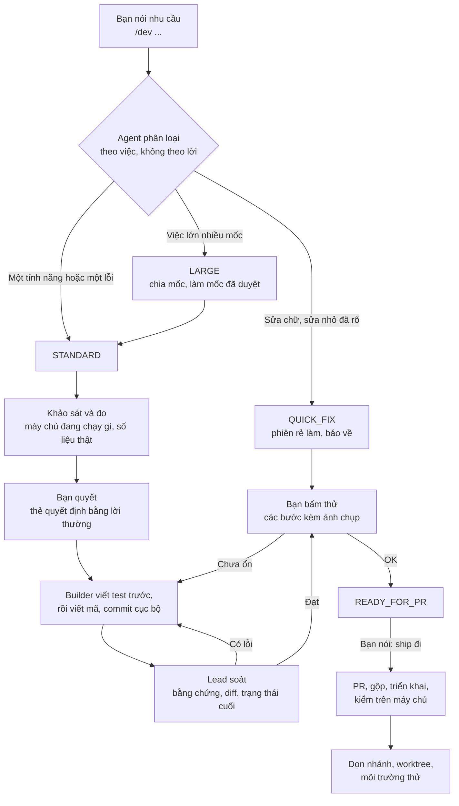

# Dev System v4.4

Bản này thay thế bộ v3 và bản 4.0 (xem [CHANGELOG.md](CHANGELOG.md)). Giữ hai skill phương pháp: `dev-guardrails`
và `release-housekeeping`. Phân loại scope, giao việc và ba tier vẫn nằm
trong workflow, không nằm trong skill dev.

## Nhìn nhanh: quy trình giúp gì

Bạn nói nhu cầu và quyết các câu hỏi nghiệp vụ. Agent lo phần còn lại, và mỗi
chặng có một điểm dừng để lỗi không đi tiếp sang chặng sau.

Nếu sơ đồ không hiện: nhu cầu → phân loại → khảo sát và đo → bạn quyết →
test trước rồi mã → lead soát → bạn bấm thử → READY_FOR_PR → "ship đi" →
triển khai và kiểm → dọn dẹp.

| Điểm dừng | Nó chặn loại lỗi nào | Ví dụ từ lượt chạy thật trên LH-ERP |
| --- | --- | --- |
| Khảo sát và đo | Quyết định dựa trên giả định | Ngưỡng so chữ giả định 0,70, đo ra phải là 0,30 |
| Bạn quyết | Agent tự chọn thay bạn về nghiệp vụ | 8 quyết định của một thay đổi được ghi lại kèm phương án đã bỏ |
| Test trước rồi mã | Mã chạy được nhưng sai yêu cầu | Lỗi được tái hiện bằng test trước khi sửa |
| Lead soát | Báo "đạt" nhưng kết quả sai | Test đạt 60/60 trong khi đơn vị bị đổi từ Hộp sang ml |
| Bạn bấm thử | Đúng theo test nhưng khó dùng | Phần dưới của cửa sổ soát được làm lại sau khi bạn xem |
| Kiểm trên máy chủ | Script báo thành công nhưng thiếu thứ gì đó | Triển khai báo xong trong khi thiếu một model |
| Dọn dẹp | Nhánh, container, tệp tạm tồn lại | Giữ volume, xoá phần còn lại, hỏi bạn một lần |

Quyền của bạn nằm ở ba chỗ: quyết nghiệp vụ, bấm thử, và nói "ship đi".
Agent không đẩy mã, không gộp và không triển khai khi chưa có câu đó.

## Cài bằng agent

Đọc [INSTALL-HANDOFF.md](INSTALL-HANDOFF.md), hoặc giao file tự chứa
`INSTALL-DEV-SYSTEM.md` được cung cấp riêng. File tự chứa có cả bộ cài;
đặt ở thư mục bất kỳ và chỉ rõ repo đích. Giữ cấu hình riêng cũ,
cài trong worktree setup riêng; chưa commit/push/merge/deploy hoặc dọn Docker.

## Một lệnh để bắt đầu

- Claude Code: `/dev <nhu cầu>` sau khi cài adapter đúng.
- Codex: `$dev <nhu cầu>` hoặc bộ chọn skill thực tế.
- Host tự xây: cần binding `/dev` thực sự, không chỉ viết trong Markdown.

Adapter chỉ trỏ đến [dev-router.md](workflow/dev-router.md); không sao chép
quy tắc routing hay tạo một hệ thống agent mới.

| Luồng | Cách làm |
| --- | --- |
| QUICK_FIX | Sửa chữ, docs, khoảng cách (không đổi logic): nhánh ngắn, commit message, một check. Sửa hành vi nhỏ, rõ và ít rủi ro: ghi yêu cầu ngắn, TDD/check phù hợp, review gọn. |
| STANDARD | Một feature hoặc bug cần điều tra: spec gọn, vertical tasks, main review và cùng builder fix. |
| LARGE | Lập hướng tổng thể, chia mốc và chỉ build mốc được duyệt cho phiên hiện tại. |

Scope, rủi ro và tier là các trục khác nhau. Sửa một dòng phân quyền
không phải quick fix ít rủi ro. Agent tự phân luồng và nêu lý do;
chỉ hỏi bạn các quyết định có ảnh hưởng thực sự.

Mọi change dùng worktree riêng, trừ sửa chữ/docs/khoảng cách trong QUICK_FIX
(chỉ cần nhánh ngắn). Tất cả luồng vẫn cần bằng chứng thật, TDD khi sửa hành vi
và gate trước PR.

- Commit: agent được commit cục bộ trên nhánh của change. Push, PR, merge và
  deploy vẫn cần quyền riêng.
- Song song: các change không đụng nhau được chạy song song, mỗi change một
  worktree; agent báo cho bạn biết change nào chạy song song và vì sao.
- Xem tận mắt: với thay đổi bạn nhìn thấy hoặc dùng được, agent đưa các bước
  bấm thử kèm ảnh chụp và chờ bạn OK trước READY_FOR_PR.
Đọc [daily-workflow.md](workflow/daily-workflow.md) và [prompts.md](workflow/prompts.md).

## Giữ môi trường test tái sử dụng

Dọn dữ liệu của lượt test, không xóa baseline/schema/lịch sử migration.
Môi trường chung/luôn bật: giữ dịch vụ. Môi trường riêng đang rảnh:
có thể dọn container hợp lệ nhưng GIỮ volume, cấu hình và cách khởi động lại.
Không xóa worktree nếu môi trường giữ lại còn phụ thuộc vào nó.
Giữ tài nguyên đúng chính sách vẫn là hoàn tất housekeeping.

## Giới hạn

Đây là hướng dẫn cho agent, chưa phải dispatcher hoặc cơ chế cưỡng chế.
Xem [VALIDATION.md](VALIDATION.md). Chưa chạy trên repo/host/Docker của bạn;
20 tình huống agent trong gói là bộ kỳ vọng, chưa phải benchmark đã chạy.
File tự chứa `INSTALL-DEV-SYSTEM.md` và các ZIP dựng cho 4.0 chưa được dựng lại;
cài 4.4 từ thư mục này.
